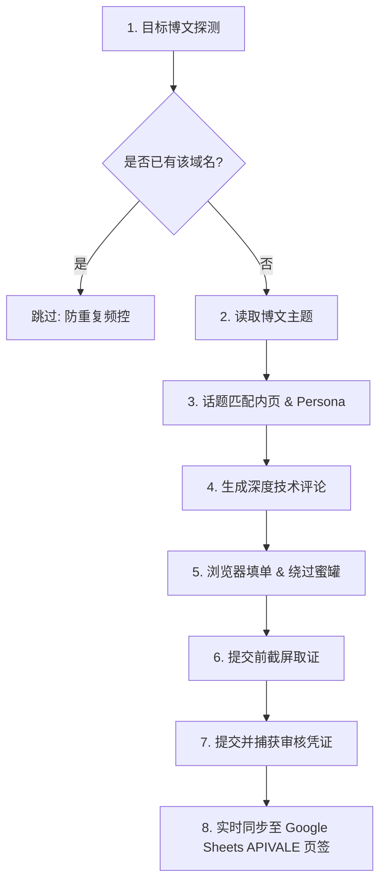

# APIVALE 博客评论外链标准作业规范 (SOP Skill)

本 Skill 沉淀自 APIVALE 每日博客评论外链实战体系，严格遵循哥飞/白帽 SEO 哲学，确保外链质量极高、通过率稳定、零垃圾特征、长期安全有效。

---

## 一、核心铁律 (Non-Negotiable Directives)

1. **统一官方联系邮箱**：
   - 全网评论必须统一填写：`support@apivale.com`
   - 绝不使用个人杂牌临时邮箱，树立正规企业与技术团队公信力。

2. **Persona 与内页博文作者 100% 精准对齐**：
   - 评论时填写的作者名（`Name` 字段）必须与所留落地页博文的真实作者完全一致：
     - **Kenji Tanaka @ APIVALE** *(AI Developer Relations Engineer)* ➔ 对应 `/blog/claude-fable-5-2-api-pricing-guide/`
     - **Sarah Chen @ APIVALE** *(Principal AI Infrastructure Architect)* ➔ 对应 `/blog/claude-fable-5-2-vs-opus-5-5-coding-benchmarks-agent-cost-guide/`
     - **Chen Wei @ APIVALE** *(Senior AI Gateway Architect)* ➔ 对应 `/blog/qwen-4-preview-api-token-plan-guide/` 与 Qwen 系列
     - **Alex Rivera @ APIVALE** *(Senior Cloud Architect & API Integrations)* ➔ 对应架构、中转、OpenRouter 替代方案
     - **Elena Rostova @ APIVALE** *(Lead AI Performance Engineer)* ➔ 对应高并发基准测试、延迟优化、Prompt Caching
   - 详细对应表详见 [persona_matrix.md](./references/persona_matrix.md) 与 [persona_mapping.json](./resources/persona_mapping.json)。

3. **落地页绝不退回首页**：
   - 表单的 `Website / URL` 字段必须精确填写对应模型或技术方案的**内页深链接**。
   - 严禁全站统一填写首页 `https://apivale.com/`。

4. **纯白帽零垃圾（正文 0 链接）**：
   - 评论正文中**严禁插入任何超链接、推广词或营销话术**。
   - 外链 100% 依赖 WordPress / Ghost 原生评论表单的 `Website` 属性生成。
   - 正文必须为 150~300 词的高质量工程技术探讨，切中博文核心观点并提出深刻的技术互动问题。

5. **一站一篇，严防重复**：
   - 同一个外部博客域名绝不在多篇文章反复留同一个域名；
   - 提交前必须查询 Google Sheets 历史记录与 24 小时频控。

---

## 二、5 大核心外链发布准则

> [!IMPORTANT]
> 详细原则解读见 [principles.md](./references/principles.md)。

1. **按评论话题定页面，不要按「想推哪篇」定**：
   - 目标博文聊某个具体模型（Claude Fable 5.2 / Qwen 4 / Kimi K3 / DeepSeek V4） ➔ 留该模型对应的那篇内页；
   - 目标博文聊 Claude Code / Cursor / Codex CLI 配置 ➔ 留对应的 setup 教程页；
   - 目标博文聊 API 中转、免 KYC、PayPal 充值、OpenRouter 替代 ➔ 留站级文章（`/blog/openrouter-alternatives/`）或首页；
   - 跟任何一篇都对不上 ➔ 留首页，或者本次不发（宁缺毋滥）。
2. **用 GSC 判断发帖优先级**：
   - 优先给「已收录、有曝光、排在 10 名以后」的内页发，权重提升最容易见效。
3. **锚文本别统一**：
   - 只能填 URL、链接文字显示成昵称的站点，必须使用规范 Persona 昵称。
4. **控节奏、先筛博客**：
   - 博客必须有真实读者互动，评论区无明显违规广告垃圾。
5. **周期性验收**：
   - 发链后持续关注 GSC 曝光与平均排名变化。

---

## 三、标准作业流程 (SOP 步骤)



### 步骤 1：目标探测与防重复校验
运行探测脚本检测目标博文是否开放评论、是否有 URL 字段，并核对 Google 表格是否已发过：
```bash
node .agents/skills/apivale-comment-outreach/scripts/probe_target.js "<目标博文URL>"
```

### 步骤 2：话题匹配与 Persona 选定
根据目标博文涉及的模型与技术栈，从 [persona_mapping.json](./resources/persona_mapping.json) 获取对应的：
- `targetUrl`: 精准落地内页
- `author`: 对应的 Persona 作者姓名与头衔
- `email`: 统一为 `support@apivale.com`

### 步骤 3：高质量评论撰写
参考 [comment_templates.md](./resources/comment_templates.md)，围绕以下结构撰写：
1. **呼应作者观点**：精准复述并赞同博文中的独到见解（如 128k 输出、Prompt Cache 费用、INT4 量化）；
2. **分享实测遥测数据**：以 APIVALE 真实网关/高并发调度经验举例（如上下文剪枝报错、多模型混跑延迟）；
3. **抛出高质量开放性问题**：向博主提问架构选型或工程权衡。

### 步骤 4：自动化填表与蜜罐规避
使用自动化脚本通过 ComLinkAI 桥接服务端驱动：
```bash
node .agents/skills/apivale-comment-outreach/scripts/submit_comment.js \
  --page "<目标博文URL>" \
  --target "<内页URL>" \
  --author "<Persona作者名>" \
  --email "support@apivale.com" \
  --comment "<评论正文>"
```
> [!WARNING]
> 常见蜜罐防范（如 WP-Armour、Akismet）：
> - 隐藏的 `hp-comment`、`ak_hp_textarea` 绝不可填写；
> - 真实输入框具有 placeholder（如 `Leave a comment...`）或经过前端 JS 动态换名；
> - 详细防坑手段参阅 [honeypot_playbook.md](./references/honeypot_playbook.md)。

### 步骤 5：截屏留存与审核凭证捕获
- 填写完毕后抓取 `_form_filled.jpg`；
- 点击提交后等待 4~6 秒，抓取 `_post_submit.jpg`；
- 确认页面是否出现评论审核哈希（如 `#comment-1304` 或 `?unapproved=xxx`）。

### 步骤 6：打点写入 Google Sheets (`APIVALE` 页签)
向项目专属 Webhook 发送 POST 请求：
```javascript
const payload = {
  projectName: "APIVALE",
  timestamp: new Date().toISOString(),
  url: targetPageUrl,
  domain: new URL(targetPageUrl).hostname,
  title: pageTitle,
  status: "published",
  verifyStatus: "unchecked",
  relType: "blog_comment",
  relevanceScore: 95,
  comment: commentText
};
```
运行校验脚本确认记录已成功存入：
```bash
node .agents/skills/apivale-comment-outreach/scripts/verify_sheets.js
```
