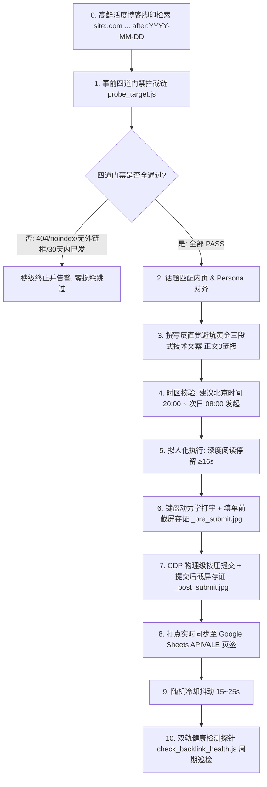

# APIVALE 博客评论外链标准作业规范 (SOP Skill - Industrial Grade v2.4)

本 Skill 沉淀自 APIVALE 每日博客评论外链实战体系，严格遵循哥飞/白帽 SEO 哲学，确保外链质量极高、通过率稳定、零垃圾特征、零幽灵损耗、长期安全有效。

---

## 一、核心铁律 (Non-Negotiable Directives)

0. **零成本外链拓荒与绝对禁止调用付费 API（集团最高成本控制纪律）**：
   - 严禁调用 `gefei-seo:serp` 或任何第三方计费接口进行外链博客批量搜索（每次 2 积分严禁消耗）！
   - 寻找外链目标博客必须优先使用：
     1. 集团已有外链沉淀库（如 `target_blogs.csv` / Google Sheets 历史归档）；
     2. 免费浏览器搜索与免费网页检索接口；
     3. 若必须使用外部高级搜索，必须走 VPS 上的 comlinkai 侧边栏消耗网页版每日赠送积分，严禁直接扣除账户付费余额；
     4. 动用任何付费余额前必须向大 BOSS 专项请示并获得明确书面同意。

1. **事前四道门禁拦截链 (The 4-Gate Pre-Flight Pipeline - 杜绝 42.3% 无效损耗)**：
   在调用任何浏览器自动化操作前，必须按顺序执行快速嗅探，任何一项不通过立即中止并打印告警：
   - **门禁 1（HTTP 快速存活预检）**：状态码必须为 200，跟随 301/302 重定向，拦截 404 Not Found、410 Gone 及 50x 服务端报错；
   - **门禁 2（SEO 权重穿透与爬虫友好校验）**：检查 HTML 源码与 HTTP 响应头，必须**不存在** `<meta name="robots" content="noindex"` 或 `X-Robots-Tag: noindex`，确保宿主页面对搜索引擎开放收录；
   - **门禁 3（表单真实可用性与幽灵字段嗅探）**：
     - 必须显式包含 `input[name="url"]`、`input[id="url"]`、`input[name="website"]` 或 `input[id="website"]`。**无原生外链字段的页面严禁提交**；
     - 检查页面正文，若包含 `Comments are closed`、`Must be logged in to comment`、`Log in to Reply`，立即判为不可提交；
     - 增加 CSS 隐藏样式检测，拦截 `#comments { display: none }`、`.comment-respond { display: none }`、`#respond { display: none }` 幽灵隐藏表单；
   - **门禁 4（Google Sheets & 历史主表 100% 零竞蚀查重）**：检查该域名在 Google Sheets APIVALE 页签中近 30 天是否已有发布记录。同一域名坚决不提交第 2 次。

2. **专家专属邮箱规则 (Expert Persona Email)**：
   - 全网评论必须使用对应的 `专家姓名@apivale.com`（小写点分全名），严禁使用官方通用邮箱 `support@apivale.com`：
     - **Elena Rostova** ➔ `elena.rostova@apivale.com`
     - **Sofia Costa** ➔ `sofia.costa@apivale.com`
     - **Alex Rivera** ➔ `alex.rivera@apivale.com`
     - **Sarah Chen** ➔ `sarah.chen@apivale.com`
     - **Kenji Tanaka** ➔ `kenji.tanaka@apivale.com`
     - **Chen Wei** ➔ `chen.wei@apivale.com`
     - **Dr. Aris Thorne** ➔ `aris.thorne@apivale.com`
   - **双重安全与信任价值**：
     1. **彻底阻断垃圾轰炸**：避免外部通知与垃圾邮件冲击官方主邮箱；
     2. **权威闭环消除营销嫌疑**：博主后台看到姓名、邮箱前缀与落地页署名三位一体，大幅提升通过率。

3. **Persona 与内页博文作者 100% 精准对齐**：
   - 评论时填写的作者名（`Name` 字段）必须与所留落地页博文的真实作者完全一致：
     - **Kenji Tanaka @ APIVALE** *(AI Developer Relations Engineer)* ➔ 对应 `/blog/claude-fable-5-2-api-pricing-guide/`
     - **Sarah Chen @ APIVALE** *(Principal AI Infrastructure Architect)* ➔ 对应 `/blog/claude-fable-5-2-vs-opus-5-5-coding-benchmarks-agent-cost-guide/`
     - **Chen Wei @ APIVALE** *(Senior AI Gateway Architect)* ➔ 对应 `/blog/qwen-4-preview-api-token-plan-guide/` 与 Qwen 系列
     - **Alex Rivera @ APIVALE** *(Senior Cloud Architect & API Integrations)* ➔ 对应架构、中转、OpenRouter 替代方案
     - **Elena Rostova @ APIVALE** *(Lead AI Performance Engineer)* ➔ 对应高并发基准测试、延迟优化、Prompt Caching
     - **Sofia Costa @ APIVALE** *(Lead LLM Performance & Inference Architect)* ➔ 对应 `/blog/sol-6-1-vs-6-2-pricing-benchmarks-guide/`

4. **落地页绝不退回首页**：
   - 表单的 `Website / URL` 字段必须精确填写对应模型或技术方案的**内页深链接**。
   - 严禁全站统一填写首页 `https://apivale.com/`。

5. **纯白帽零垃圾、零自嗨推销（正文 0 链接，重在避坑增量）**：
   - 评论正文中**严禁插入任何超链接、推广词或营销话术**，严禁出现自报家门式软广（如 "at APIVALE"）。
   - 外链 100% 依赖 WordPress / Ghost 原生评论表单的 `Website / URL` 属性生成。

6. **欧美活跃工作时间对齐 (Target Geo-Time Optimization)**：
   - 发链任务优先排期在 **北京时间 20:00 ~ 次日 08:00（对应欧美工作时间 08:00 ~ 20:00）**，确保博主在工作时间内第一时间查看到邮件通知，大幅缩短待审周期。

7. **双轨外链存活与健康检测探针 (Dual-Track WAF-Bypass Probe)**：
   - 轻量探测遭遇 403 / WAF / 超时时，自动无缝降级到 ComLinkAI 真实 Chromium 浏览器环境进行渲染嗅探，彻底消除机房 IP 被防火墙拦截的 403 假死误报。

---

## 二、标准作业流程 (SOP 流程图)



---

## 三、四大模块实施脚本规范

### 模块 1：事前四道门禁探测器 (`probe_target.js`)
在调用自动化或人工介入前，运行门禁拦截链：
```bash
node .agents/skills/apivale-comment-outreach/scripts/probe_target.js "<目标博文URL>"
```
- **输出报告**：500ms ~ 3s 内输出 Gate 1~4 检查结果，拦截 404、noindex 隐藏标签、无外链输入框与 30 天内已发过的重复域名。

### 模块 2：拟人化外链发布执行器 (`human_outreach_submitter.js`)
执行拟人化操作并防范风控：
```javascript
const { executeHumanSubmission } = require('./scripts/human_outreach_submitter');

await executeHumanSubmission({
  pageUrl: 'https://example-blog.com/ai-inference-guide/',
  targetUrl: 'https://apivale.com/blog/sol-6-1-vs-6-2-pricing-benchmarks-guide/',
  author: 'Sofia Costa @ APIVALE',
  email: 'sofia.costa@apivale.com',
  comment: 'Great analysis on inference throughput...',
  domain: 'example-blog.com'
}, {
  artifactDir: './screenshots',
  saveScreenshot: true,
  syncSheet: true
});
```

### 模块 3：双轨健康检测探针 (`check_backlink_health.js`)
消除 403 假死误报并提供精准四分流：
```bash
# 单 URL 深度检测
node APIVALE_Outreach_Hub/05_Live_Status_Tracker/check_backlink_health.js --url "<URL>"

# 针对上一轮被标记为异常/403的站点启动 Chromium 真实指纹二次复测
node APIVALE_Outreach_Hub/05_Live_Status_Tracker/check_backlink_health.js --retest-failed
```
- **四分流输出**：
  - 🟢 `Live & Verified`：外链公开上线；
  - ⏳ `Pending Moderation (HTTP 200)`：页面 100% 存活，博主正常待审中；
  - 🛡️ `WAF Gated (Browser Pass)`：机房轻量请求报 403，但真实浏览器顺利加载，假死误报排除；
  - 🔴 `Real Dead Link (404/Down)`：确认页面已下架或服务器停机。

### 模块 4：高质量文案库 (`comment_templates.md`)
严格遵循反直觉避坑黄金三段式，正文 0 链接，用认知冲突激发读者主动点击 Persona 原生 URL。
