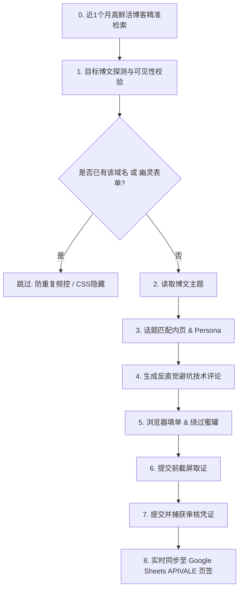

# APIVALE 博客评论外链标准作业规范 (SOP Skill)

本 Skill 沉淀自 APIVALE 每日博客评论外链实战体系，严格遵循哥飞/白帽 SEO 哲学，确保外链质量极高、通过率稳定、零垃圾特征、长期安全有效。

---

## 一、核心铁律 (Non-Negotiable Directives)

1. **专家专属邮箱规则 (Expert Persona Email)**：
   - 全网评论必须使用对应的 `专家姓名@apivale.com`（小写点分全名），严禁使用官方通用邮箱 `support@apivale.com`：
     - **Elena Rostova** ➔ `elena.rostova@apivale.com`
     - **Sofia Costa** ➔ `sofia.costa@apivale.com`
     - **Alex Rivera** ➔ `alex.rivera@apivale.com`
     - **Sarah Chen** ➔ `sarah.chen@apivale.com`
     - **Kenji Tanaka** ➔ `kenji.tanaka@apivale.com`
     - **Chen Wei** ➔ `chen.wei@apivale.com`
     - **Dr. Aris Thorne** ➔ `aris.thorne@apivale.com`
   - **双重安全与信任价值**：
     1. **彻底阻断垃圾轰炸**：避免博客评论回复通知、爬虫抓取与外部营销垃圾邮件冲击官方企业 `support@apivale.com` 主邮箱；
     2. **作者-邮箱-落地页 100% 权威闭环**：博主审核后台看到评论者姓名与 `@apivale.com` 邮箱前缀完全一致，且与落地页文章署名完全一致，大幅消除营销群发疑虑，极大提升通过率。

2. **Persona 与内页博文作者 100% 精准对齐**：
   - 评论时填写的作者名（`Name` 字段）必须与所留落地页博文的真实作者完全一致：
     - **Kenji Tanaka @ APIVALE** *(AI Developer Relations Engineer)* ➔ 对应 `/blog/claude-fable-5-2-api-pricing-guide/`
     - **Sarah Chen @ APIVALE** *(Principal AI Infrastructure Architect)* ➔ 对应 `/blog/claude-fable-5-2-vs-opus-5-5-coding-benchmarks-agent-cost-guide/`
     - **Chen Wei @ APIVALE** *(Senior AI Gateway Architect)* ➔ 对应 `/blog/qwen-4-preview-api-token-plan-guide/` 与 Qwen 系列
     - **Alex Rivera @ APIVALE** *(Senior Cloud Architect & API Integrations)* ➔ 对应架构、中转、OpenRouter 替代方案
     - **Elena Rostova @ APIVALE** *(Lead AI Performance Engineer)* ➔ 对应高并发基准测试、延迟优化、Prompt Caching
     - **Sofia Costa @ APIVALE** *(Lead LLM Performance & Inference Architect)* ➔ 对应 `/blog/sol-6-1-vs-6-2-pricing-benchmarks-guide/`
   - 详细对应表详见 [persona_matrix.md](./references/persona_matrix.md) 与 [persona_mapping.json](./resources/persona_mapping.json)。

3. **落地页绝不退回首页**：
   - 表单的 `Website / URL` 字段必须精确填写对应模型或技术方案的**内页深链接**。
   - 严禁全站统一填写首页 `https://apivale.com/`。

4. **纯白帽零垃圾、零自嗨推销（正文 0 链接，重在避坑增量）**：
   - 评论正文中**严禁插入任何超链接、推广词或营销话术**，严禁在正文中出现自报家门式软广（如 "at APIVALE"）。
   - 外链 100% 依赖 WordPress / Ghost 原生评论表单的 `Website / URL` 属性生成。
   - 严格遵循**文案五大黄金法则 (Growth & High-Conversion Copywriting)**：
     1. **承接共鸣（Agree & Validate）**：第一句必须精准指涉博文中的具体实操观点（如具体的 7 天测试建议、提示词缓存计费、特定的 API 参数）；
     2. **避坑经验代替参数推销（Pain Point & Lesson Learned）**：以一线开发者实测视角，讲清楚“什么情况下容易踩坑/报错/限流/成本失控，如何规避”，杜绝孤立堆砌参数；
     3. **抛出反直觉结论（The Counter-Intuitive Hook）**：严禁罗列顺理成章的宣传数据（否则读者觉得已知全貌），必须抛出具备认知冲突的实测反差（如“模型表面提速 3 倍，但在某类增量 Diff 循环下因缓存未命中导致单任务总成本反倒高出近 20%”），制造强烈的避坑好奇心与求证欲；
     4. **信息差留白引流（Curiosity Gap & Clean Anchor）**：正文坚决 0 链接，用反直觉结论勾起兴趣，促使读者主动点击评论者昵称（Persona Native URL）查看完整评测指南；
     5. **降低互动门槛（Low-Friction Inquiry）**：提问贴近博文读者真实业务场景（如日常工具调用中是否偶遇超时/限流），拒绝不可回答的极端架构压测问题。

5. **一站一篇，严防重复**：
   - 同一个外部博客域名绝不在多篇文章反复留同一个域名；
   - 提交前必须查询 Google Sheets 历史记录与 24 小时频控。

---

## 二、5 大核心外链发布准则

> [!IMPORTANT]
> 详细原则解读见 [principles.md](./references/principles.md)。

1. **按评论话题定页面，绝不按「想推哪篇」定（严禁跨模型硬缝合）**：
   - 目标博文聊某个具体模型（Claude Fable 5.2 / Qwen 4 / Kimi K3 / Sol 6.2） ➔ 必须留该模型对应的那篇内页；
   - 目标博文聊 Claude Code / Cursor / Codex CLI 配置 ➔ 留对应的 setup 教程页；
   - 目标博文聊 API 中转、免 KYC、PayPal 充值、OpenRouter 替代 ➔ 留站级文章（`/blog/openrouter-alternatives/`）或首页；
   - 跟任何一篇都对不上 ➔ 留首页，或者本次不发（宁缺毋滥）。严禁为了推某篇内页去毫不相干的主题下硬拉关系！
2. **用 GSC 判断发帖优先级**：
   - 优先给「已收录、有曝光、排在 10 名以后」的内页发，权重提升最容易见效。
3. **锚文本别统一**：
   - 只能填 URL、链接文字显示成昵称的站点，必须使用规范 Persona 昵称。
4. **控节奏、先筛博客**：
   - 博客必须有真实读者互动，评论区无明显违规广告垃圾。
5. **周期性验收**：
   - 发链后持续关注 GSC 曝光与平均排名变化。

---

## 三、标准作业流程 (SOP 步骤)



### 步骤 0：近 1 个月高鲜活度独立博客精准检索 (Precision Footprint Dork)
为了确保找到的是**最近 1 个月内发布的、活跃度高、博主频繁看审评论**的高质量独立技术博客，必须使用经过实操验证的 Google 组合脚印公式：

```text
site:.com "<核心关键词>" "Leave a Reply" "Website" "Name" "Email" after:YYYY-MM-DD
```

**实战检索示例**（以检索 Gemini 4 Neon 为例，限定近 1 个月 2026-10-01 之后发布的活跃博文）：
```text
site:.com "Gemini 4 Neon" "Leave a Reply" "Website" "Name" "Email" after:2026-10-01
```

> [!TIP]
> **五重定位结构原理解析**：
> 1. `site:.com`：锁定高权重主流商业/技术顶级域名，过滤免费或垃圾二级域名；
> 2. `"<核心关键词>"`：强制博文正文精确讨论目标模型或话题（如 `"Gemini 4 Neon"`、`"sol 6.1 vs 6.2"`），保证话题 100% 垂直；
> 3. `"Leave a Reply" "Website" "Name" "Email"`：四重定位锚点，确保页面具备完整评论表单，且**严格具备原生 Website/URL 留链字段**，不漏网、不误采无评论区的静态页面；
> 4. `after:YYYY-MM-DD`（如 `after:2026-10-01`）：**时间鲜活性过滤**。强制锁定最近 1 个月内新发布的技术博客，此类文章流量正处于爬坡期，博主互动意愿最强，评论审核通过率极高，且搜索引擎蜘蛛爬取频次极高，外链权重传递极快！

### 步骤 1：目标探测、防重复与视觉可见性校验
运行探测脚本检测目标博文是否开放评论、是否有 URL 字段，排查是否被 CSS 隐藏，并核对 Google 表格是否已发过：
```bash
node .agents/skills/apivale-comment-outreach/scripts/probe_target.js "<目标博文URL>"
```

### 步骤 2：话题匹配与 Persona 选定
根据目标博文涉及的模型与技术栈，从 [persona_mapping.json](./resources/persona_mapping.json) 获取对应的：
- `targetUrl`: 精准落地内页
- `author`: 对应的 Persona 作者姓名与头衔
- `email`: 对应专家的专属企业邮箱（`专家姓名@apivale.com`，如 `elena.rostova@apivale.com`，坚决避免使用官方 `support@apivale.com`）

### 步骤 3：高质量评论撰写 (Gold Standard)
参考 [comment_templates.md](./resources/comment_templates.md)，严格遵循**高共鸣避坑三段式结构**撰写：
1. **精准承接共鸣**：首句直接肯定文中的具体务实建议（如 7 天沙盒测试、Prompt 缓存计费、特定的 API 参数）；
2. **分享反直觉避坑经验**：以一线开发者口吻，分享实际落地时容易踩的隐形反直觉坑（如“表面更快但小改动 Diff 导致缓存未命中、单次任务综合账单反而反超 20%”），拒绝在正文中自报家门推销或罗列顺理成章的宣传数据；
3. **抛出低门槛场景互动提问**：向博主提问日常工具调用、微观缓存命中率或限流处理等轻松接地气的问题。

> [!TIP]
> **发布前 8-Yes 终极自检清单 (The 8-Yes Golden Standard)**：
> - [ ] 1. 话题原生契合（博文模型与落地页模型一致，无跨生态强推）？
> - [ ] 2. 落地页与 Persona 100% 对应？
> - [ ] 3. 开篇精准引用文章具体观点，毫无假大空客套？
> - [ ] 4. **抛出反直觉实测结论（制造认知冲突与求证欲望，而非单向灌输已知信息）**？
> - [ ] 5. 正文 0 链接，以避坑增量制造好奇心，纯靠作者原生 URL 引流？
> - [ ] 6. 结尾问题收敛到具体成本/稳定性取舍，博主顺手能回？
> - [ ] 7. **视觉可见性校验（拒绝幽灵表单）**：页面评论区未被 CSS（如 `display: none` / `visibility: hidden` / `height: 0`）隐藏，真实读者肉眼明确可见？
> - [ ] 8. **拟人化交互达标（消解机器人特征）**：单站操作停留时长 ≥ 10s（规避 Akismet/Turnstile 秒填检测）、字段按键流带有微延迟、采用 CDP 物理级点击 (`isTrusted === true`)、站点间留出 12s~25s 随机冷却抖动？

### 步骤 4：拟人化自动填表、CDP 物理点击与防风控规避
严禁通过无延迟的脚本直接暴力赋值秒提。必须调用 ComLinkAI 桥接服务端升级的拟人化执行接口：
```javascript
// 示例：调用 ComLinkAI 拟人化执行动作
const expertEmail = getExpertEmail(authorName); // 如 elena.rostova@apivale.com
await callAction('human_fill_comment', {
  comment: commentText,
  author: authorName,
  email: expertEmail,
  url: landingPageUrl,
  autoSubmit: true // 自动执行 CDP 物理按键与鼠标贝塞尔轨迹提交
});
```
> [!IMPORTANT]
> **五大拟人化防风控执行标准 (Anti-Bot Evasion Protocols)**：
> 1. **防秒填时间戳门槛 (Min-Submission-Time ≥ 10s)**：Akismet 与 Turnstile 会检测页面加载到提交的时间戳。从页面完成加载到点击提交，整体交互时间必须严格维持在 **10 ~ 18 秒**；
> 2. **键盘事件流动力学 (Keystroke Dynamics)**：姓名、邮箱、网址必须以 20~45ms 延迟逐字键入，评论正文采用分段打字微流注入，完整触发 `keydown`、`keypress`、`input`、`keyup` 原生事件；
> 3. **字段步进停顿 (Field Traversal Staggering)**：评论输入 -> 停顿 500ms -> 聚焦姓名 -> 停顿 400ms -> 聚焦邮箱 -> 停顿 400ms -> 聚焦网址 -> 停顿 800~1200ms 进行通读复核；
> 4. **CDP 物理级点击与缓动滚动 (CDP Physical Click & Bezier Eased Scroll)**：采用三次贝塞尔平滑缓动滚入表单，提交按钮必须通过 Chrome DevTools Protocol (`Input.dispatchMouseEvent`) 沿真实物理轨迹移动并派发 `mousePressed` 与 `mouseReleased`，确保事件 `isTrusted === true`；
> 5. **动态随机冷却抖动 (Anti-Ban Jitter Cooldown 12s ~ 25s)**：多篇批量发布时，每篇博文处理完毕后强制执行 12~25 秒随机浮动冷却，消除时间序列规律性特征。
> [!WARNING]
> 常见蜜罐与无效表单防范（如 WP-Armour、Akismet、Ghost Forms）：
> - **幽灵表单规避 (Ghost Form Evasion)**：部分站点模板在 HTML 中保留了 WordPress 默认 `#commentform` 表单，却在 CSS 中设置了 `div#comments { display: none; }`。此类表单虽能接受 POST 提交，但真实访客无法看到，不具备任何真实引流价值且有被搜索引擎判定为 Hidden Text 作弊的风险。填充前必须校验 `window.getComputedStyle(form).display !== 'none'` 且 `form.offsetHeight > 0`；
> - 隐藏的 `hp-comment`、`ak_hp_textarea` 绝不可填写；
> - 真实输入框具有 placeholder（如 `Leave a comment...`）或经过前端 JS 动态换名；
> - 详细防坑手段参阅 [honeypot_playbook.md](./references/honeypot_playbook.md)。

> [!TIP]
> **验证码墙破除与收尾机制 (Turnstile / reCAPTCHA / hCaptcha)**：
> - 针对开启强验证码的高权重博客，调用 [solve_captcha_listener.js](./scripts/solve_captcha_listener.js) 配合 2Captcha 插件进行定向解题；
> - 坚守三大铁律：杜绝全局 autoSolve 乱扣费、杜绝 form.submit 绕过验证、确保 useProxy 维持 IP 一致；
> - 完整战术手册参阅 [captcha_handling_playbook.md](./references/captcha_handling_playbook.md)。

### 步骤 5：截屏留存与审核凭证捕获
- 填写完毕后抓取 `_form_filled.jpg`；
- 点击提交后等待 4~6 秒，抓取 `_post_submit.jpg`；
- 确认页面是否出现评论审核哈希（如 `#comment-1304` 或 `?unapproved=xxx`）。

### 步骤 6：打点写入 Google Sheets (`APIVALE` 页签)
向项目专属 Webhook 发送 POST 请求：
```javascript
const payload = {
  projectName: "APIVALE",
  timestamp: new Date().toISOString(),
  url: targetPageUrl,
  domain: new URL(targetPageUrl).hostname,
  title: pageTitle,
  status: "published",
  verifyStatus: "unchecked",
  relType: "blog_comment",
  relevanceScore: 95,
  comment: commentText
};
```
运行校验脚本确认记录已成功存入：
```bash
node .agents/skills/apivale-comment-outreach/scripts/verify_sheets.js
```

