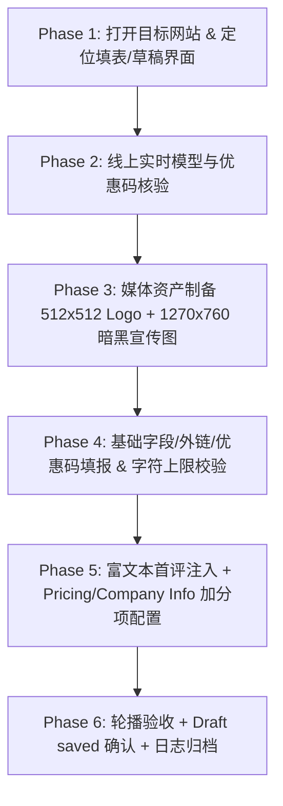

# APIVALE 外链与软件发布平台自动化填表规范 (Directory & Product Hunt Launch Skill)

本 Skill 沉淀自 **APIVALE (`apivale.com`)** 在 **Product Hunt (DR 92)** 的实战填表全流程，覆盖从**打开目标网站 $\to$ 定位填表/草稿界面 $\to$ 媒体资产制备 $\to$ 合规文案与结构化注入 $\to$ 验收锁存**的完整闭环，适用于 Product Hunt 及同类海外软件目录站（AlternativeTo, Futurepedia, Toolify 等）的标准化复用。

---

## 一、核心铁律与安全红线 (Non-Negotiable Directives)

1. **草稿锁存红线（严禁自动排期/发布）**：
   - 除非用户明确书面下达“立即发布/排期”，否则**严禁点击 `Schedule launch`、`Create draft`（最终发布态）或 `Publish/Submit for review` 等不可逆按钮**。
   - 所有自动化流程必须停留在 **`✓ Draft saved`** 状态，由人工复核后自主决定上线窗口。
2. **文案去敏感与收单合规（严禁 `Zero-KYC`）**：
   - 严禁在 Tagline、Description 或外链标题中出现 `Zero-KYC`、`Anonymous`、`No-ID` 等词汇（极易触发 Stripe/PayPal 风控冻结及竞品恶意举报）。
   - 统一使用能力与无摩擦体验导向文案（如 `PayPal accepted`、`zero-friction instant access`、`OpenAI-compatible`）。
3. **100% 真实模型对齐原则（禁止臆测旧型号）**：
   - 填表前必须先实测或核对 `https://apivale.com/pricing` 实时在售模型清单（当前基准：`DeepSeek-V4.1 Flash`、`DeepSeek-V4 Pro`、`Qwen 3.8 Max`、`GLM-5.3 Flash`、`Moonshot Kimi K3`），确保文案、定价、首评代码块与线上 100% 一致。
4. **Chrome 原生系统安全弹窗处理**：
   - 连接本机 Chrome `9222` 调试端口时，若浏览器弹出 **“要允许远程调试吗？”** 原生安全对话框，该弹窗位于网页 DOM 之外，CDP 无法穿透点击，**必须提示用户亲手点击「允许」**后方可继续。
5. **纯 ASCII 路径上传规范**：
   - 通过 `DOM.setFileInputFiles` 上传图片至 S3/Product Hunt 时，待上传文件必须位于**纯 ASCII 路径**（如 `C:\Users\Administrator\...`），避免中文目录路径导致 Multipart `Content-Disposition` 编码失败。
6. **PowerShell 脚本执行规范**：
   - 禁止在 PowerShell 中使用多行内联 `node -e "..."`（极易因引号转义报 `SyntaxError`）。一律编写独立 `.js` 脚本后运行 `node <script>.js`。

---

## 二、端到端标准作业流程 (6-Phase Execution SOP)

### Phase 1：打开目标网站与定位填表界面
1. 读取 `C:\Users\Administrator\AppData\Local\Google\Chrome\User Data\DevToolsActivePort` 获取端口与 WebSocket 路径（或复用 `scripts/cdp_helper.js`）。
2. 在目标站点（如 `https://www.producthunt.com/`）：
   - 优先检查已打开标签页中是否已存在草稿页（如 `producthunt.com/posts/new/...`）；
   - 若无，则导航至 `https://www.producthunt.com/`，定位顶栏 **`Submit`** 按钮（或访问 `/posts/new`），进入提交/编辑表单。
3. 运行 `scripts/ph_form_inspector.js` 探测页面结构：
   - 确认右侧准备度清单（`[data-test^="readiness-"]`）与关键交互按钮（`Edit logo`、`Edit gallery`、`Manage links`、`Add pricing`、`Edit promo code`）。

### Phase 2：线上实时模型与优惠码核验
1. 核对 `resources/apivale_launch_profile.json` 中的基准文案与 `https://apivale.com/pricing` 实时网页内容是否一致。
2. 核对裂变/社区优惠码（如 `PRODUCTHUNT`），确认兑换路径与额度描述无误。

### Phase 3：媒体资产制备（黄金视觉标准）
1. **Logo（1:1 正方形）**：
   - 严禁使用长方形网页截图直接充当 Logo（在 40×40~80×80 信息流中会被严重压扁）。
   - 使用 **512 × 512** 暗黑背景 + `apivale.com/logo.svg` 官方渐变四芒星矢量图标。
2. **Gallery 宣传画廊（3 张以上，1270 × 760 暗黑模式）**：
   - **图 1**：官方英文 Hero 首屏（展示四大模型总览）。
   - **图 2**：`10s Quickstart (Change 1 Line)` 代码差异对比与三大高可用保障。
   - **图 3**：`High-Throughput Flash Trio` 模型矩阵与透明定价卡片。
   - 运行 `scripts/capture_apivale_media.js` 自动强制开启 `.dark` 主题、隐藏遮挡的 `fixed` 顶栏与浮窗、精准滚动并保存至纯 ASCII 路径。
   - **必检**：每次截图后必须用 `read_file` 目视检查，杜绝 SPA 滚动未渲染导致的黑屏帧或浅色重复帧。

### Phase 4：基础字段、生态外链与社区优惠码填报
严格遵循平台硬性字符约束（见 `resources/apivale_launch_profile.json`）：
- **Launch Name**: `APIVALE`
- **Tagline ($\le 60$ 字符)**: `Chinese AI API gateway for DeepSeek, Qwen, Kimi & GLM` (53 字符)
- **Description ($\le 500$ 字符)**: 286 字符（突出 OpenAI 兼容、PayPal、免阻力试用）
- **Launch Tags**: `Developer Tools`, `Artificial Intelligence`, `API`
- **Manage Links (3 大开源生态矩阵)**:
  - `https://github.com/bshx2024/cursor-deepseek-template`
  - `https://github.com/bshx2024/docker-compose-deepseek-gateway`
  - `https://github.com/bshx2024/esp32-deepseek-client`
- **Promo Code / Community Deal**:
  - **Offer ($\le 25$ 字符硬限制!)**: `$0.50 Extra API Credits` (23 字符)
  - **Code**: `PRODUCTHUNT`
- **Gallery 上传**: 运行 `scripts/ph_upload_gallery.js` 打开 `[data-test="inline-edit-sheet"]`，清理旧图后注入 `#file-input-media`，轮询等待 `Save media` 按钮启用并点击保存。

### Phase 5：Maker 置顶首评与加分项配置
1. **First Comment（TipTap / ProseMirror 富文本注入）**：
   - 使用 `el.editor.commands.setContent(...)` 注入结构化内容（痛点 $\to$ 95% 成本套利实测 $\to$ 3 行接入代码 $\to$ GitHub 生态 $\to$ `PRODUCTHUNT` 兑换路径），字符数控制在 2,700~3,000 / 5,000。
2. **Pricing（定价模式）**：
   - 运行 `scripts/ph_set_pricing_and_company.js --pricing` 选中 `free_options`（**Free Options**：有免费试用额度 + 后续按量付费），点亮 `Pricing: Complete`。
3. **Company Info（公司与团队信息，选填加分）**：
   - **About the product**: 不勾选开源项目（APIVALE 为商用网关）。
   - **Funding information**: 勾选 `Bootstrapped`（独立开发/自筹资金在 PH 极受青睐）。
   - **Team size**: `1-10`。
   - **X account**: 若有官方或 Maker X 账号则填入以激活 Launch 日自动 @ 联动。

### Phase 6：最终验收与归档
1. 验证页面顶部显示 **`✓ Draft saved`**，右侧清单达到 **`10 of 14`** 以上且 `All 7 required items done`。
2. 截屏验证轮播画廊 3 张图片无黑屏、无重复、高对比度清晰可读。
3. 将本次提交详情、脚本变更与下一步行动记录更新至 `APIVALE_Outreach_Hub/02_Published_Logs/directory_submissions_log.md`。

---

## 三、目录资产结构

- `SKILL.md` — 本标准作业规范
- `resources/apivale_launch_profile.json` — APIVALE 官方合规文案、模型清单、外链与优惠码标准配置库
- `scripts/cdp_helper.js` — Chrome DevTools WebSocket 公共连接与目标页定位封装
- `scripts/capture_apivale_media.js` — 1270×760 暗黑模式宣传图一键捕获脚本
- `scripts/ph_form_inspector.js` — Product Hunt 填表页与准备度清单探测器
- `scripts/ph_upload_gallery.js` — Product Hunt 媒体抽屉清理、上传与保存自动化脚本
- `scripts/ph_set_pricing_and_company.js` — Pricing (`Free Options`) 与 Company Info (`Bootstrapped`) 配置脚本
