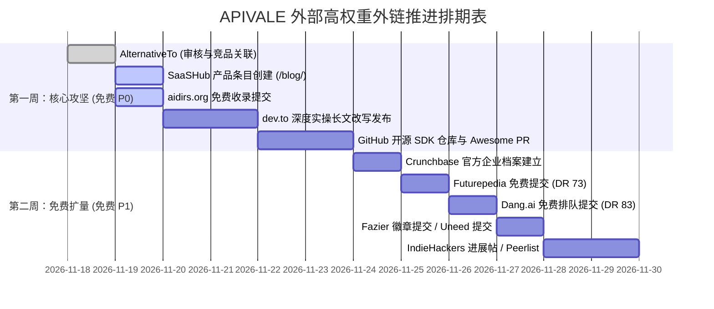

# 📊 APIVALE 全量外链渠道去重与免费/付费分级规划表

> **数据来源**：SEO Agent 实测、Ahrefs DR 数据、SimilarWeb 2026-10 流量口径及手工补测。  
> **数据补测说明**：对上一轮额度耗尽未测的 4 个站点进行了实测补齐：`GitHub (DR 96)`、`Medium (DR 94)`、`Blogger (DR 92)`、`aitoolnet (DR 57)`。  
> **状态变更说明**：`alternativeto.net` 已于今日通过 ComLinkAI 自动完成填报（处于审核队列），从待办池移至“已提报跟进”组。

---

## 一、 免费外链与免费目录资源表 (100% 零成本 · 按梯队排列)

### 🌟 梯队 1：即刻必做核心源 (高权重 · 强相关 · 免费)

| 序号 | 站点名称与网址 | DR 权威 | 月访问量 (2026-10) | 承接内页规划 (Landing Page) | 推荐 Persona | 落地实操与怎么用 | 执行状态 |
| :---: | :--- | :---: | :---: | :--- | :--- | :--- | :---: |
| **01** | **`saashub.com`** | **DR 81** | 72.8 万 | `https://apivale.com/` | APIVALE Official | **建产品条目**，重点关联对标 `OpenRouter`、`LiteLLM`，抢占竞品替代词流量。 | **本周首选 (P0)** |
| **02** | **`dev.to`** | **DR 91** | 448.5 万 | `/blog/gpt-6-2-sol-api-pricing-benchmarks-guide/` | Alex Rivera @ APIVALE | 将 Cursor/Cline 接入教程与 GPT-6.2 成本压降改写为技术长文，文末带 Canonical 原文反链。 | **本周首选 (P0)** |
| **03** | **`github.com`** | **DR 96** | 4.2 亿+ | `https://apivale.com/` 及 GitHub 开源库 | Alex Rivera @ APIVALE | 开源 APIVALE OpenAI-compatible SDK / CLI 工具包装库，向各大 `awesome-ai-gateways` 提 PR。 | **本周首选 (P0)** |
| **04** | **`aidirs.org`** | **DR 68** | 1.1 万 | `https://apivale.com/` | APIVALE Official | 处于新站免费收录红利期，直接走免费通道提交，秒级或快速收录。 | **本周首选 (P0)** |
| **05** | **`news.ycombinator.com`** | **DR 91** | 4,642 万 | `/blog/sage-s2-1-flash-api-pricing-moe-router-guide/` | Elena Rostova @ APIVALE | 发一次高质量 `Show HN: APIVALE`，讲稀疏 MoE 路由与长上下文零幻觉架构，不讲商业硬广。 | 筹备中 (P0) |
| **06** | **`reddit.com`** | **DR 95** | 37.8 亿 | 各专题落地内页 | 对应作者轮换 | 在 `r/LocalLLaMA`、`r/cursor`、`r/LLMDevs` 分享开发者实测、成本套利与接入经验贴。 | 筹备中 (P0) |
| **07** | **`alternativeto.net`** | **DR 82** | 256.8 万 | 首页与路由内页 | APIVALE Official | **建立对标 OpenRouter 的替代品条目**。 | **✅ 今日已填报完成 (审核中)** |

---

### 🚀 梯队 2：免费铺量与次批目录/开发者社区 (稳定扩量)

| 序号 | 站点名称与网址 | DR 权威 | 月访问量 (2026-10) | 承接内页规划 | 推荐 Persona | 落地实操与怎么用 | 优先级 |
| :---: | :--- | :---: | :---: | :--- | :--- | :--- | :---: |
| **08** | **`crunchbase.com`** | **DR 91** | 280.6 万 | `https://apivale.com/` | APIVALE Official | 建立公司与产品免费基础档案，为出海业务树立官方商业信任背书。 | **P1 (必做)** |
| **09** | **`futurepedia.io`** | **DR 73** | 52.8 万 | `https://apivale.com/` | APIVALE Official | 近 3 个月流量大涨 **28.4%**，全球顶级 AI 目录，直接走**免费提交**通道。 | **P1 (必做)** |
| **10** | **`dang.ai`** | **DR 83** | 55.3 万 | `https://apivale.com/` | APIVALE Official | 近 3 个月流量暴涨 **27.5%**，**坚决走免费排队档**（无需付 $50 加速）。 | **P1 (必做)** |
| **11** | **`fazier.com`** | **DR 85** | 9.8 万 | `https://apivale.com/` | APIVALE Official | 免费收录，按平台规范在首页挂载 Launch 徽章。 | P1 |
| **12** | **`indiehackers.com`** | **DR 82** | 76.0 万 | `/blog/gpt-6-2-sol-api-pricing-benchmarks-guide/` | Alex Rivera @ APIVALE | 发布出海独立开发进展贴：“*为什么我们要构建零 KYC 的多模型 API 路由网关*”。 | P1 |
| **13** | **`uneed.best`** | **DR 77** | 20.1 万 | `https://apivale.com/` | APIVALE Official | 优质独立开发产品 Launch 平台，提交首页展示，走免费排队。 | P1 |
| **14** | **`peerlist.io`** | **DR 78** | 44.0 万 | `https://apivale.com/` | APIVALE Official | 开发者专属项目展示与发布，获取同行信任与早期关注。 | P1 |
| **15** | **`aitoolnet.com`** | **DR 57** | 3.5 万 | `https://apivale.com/` | APIVALE Official | 实测 DR 57，支持免费提交 AI 工具档案收录，扩充底层收录池。 | P1 |
| **16** | **`startupfa.me`** | **DR 84** | 5.8 万 | `https://apivale.com/` | APIVALE Official | 免费 (挂徽章)，但近 3 个月流量下跌 -15.8%，作为补充渠道顺带提交。 | P2 |
| **17** | **`sideprojectors.com`**| **DR 72** | 15.9 万 | `https://apivale.com/` | APIVALE Official | 挂项目作品展示，拓展出海圈子关注度。 | P2 |
| **18** | **`promoteproject.com`**| **DR 49** | 3.9 万 | `https://apivale.com/` | APIVALE Official | 免费 (攒积分)，秒上线但 DR 仅 49 且流量以直访为主，仅作铺量。 | P2 |

---

### ⏳ 梯队 3：蓄势推进 (需积累 20+ 真实用户或老号门槛)

| 序号 | 站点名称与网址 | DR 权威 | 月访问量 | 准入门槛 / 启动时机 | 落地实操与怎么用 | 优先级 |
| :---: | :--- | :---: | :---: | :--- | :--- | :---: |
| **19** | **`producthunt.com`** | **DR 92** | 567.7 万 | 需积累 20~30 个真实活跃用户 | **一生一次的核心引爆机会**。严禁现在裸上，等素材、Hunter、首批用户就绪后再 Launch。 | 蓄势中 |
| **20** | **`v2ex.com`** | **DR 79** | 558.9 万 | 需老账号 / 邀请码 | 65.7% 流量来自中国，面向国内开发者分享免海外信用卡、PayPal 充值使用前沿模型的合规方案。 | 条件成熟做 |
| **21** | **`medium.com`** | **DR 94** | 1 亿+ | 需建立正规 Publication | 长文科普与思想领导力沉淀，但外链权重传递弱于 dev.to，优先级往后排。 | 条件成熟做 |

---

### ⚠️ 低效/辅助工具 (不建议单独投入精力)

| 序号 | 站点名称 | 费用 | 现状诊断说明 | 处理建议 |
| :---: | :--- | :---: | :--- | :--- |
| **22** | **`blogger.com`** | 免费 | Google 自家博客平台，内容博客形态，缺乏垂直技术受众，不适合产品站外链。 | ❌ 不建议做 |
| **23** | **`backlinkdirs.com`**| 免费 | 纯目录导航聚合工具，并非直接留链站点。 | 🔍 仅作为查找新站的辅助工具 |

---

## 二、 付费与含收费选项渠道表 (避坑与策略指引)

> 💡 **核心战略裁决**：APIVALE 当前处于冷启动阶段（DR 较低），买付费收录和高价外链 ROI 极低。**凡提供免费档的坚决走免费排队，流量崩塌的收费站坚决不花一分钱！**

| 序号 | 站点域名 | 标价情况 | 真实权威 (DR) | 真实流量与趋势诊断 | 裁决行动策略 |
| :---: | :--- | :---: | :---: | :--- | :--- |
| **01** | **`theresanaiforthat.com`** | 免费排队 / 付费加速 | **DR 77** | 月访 432.4 万，历史头部 AI 大站 | **✅ 走免费排队通道**，坚决不买几十美元的付费加速包！ |
| **02** | **`toolify.ai`** | 免费提交 / 付费推广$99 | **DR 73** | 月访 97.9 万，出海高知名度站 | **✅ 走免费提交模式**，不花 $99 刀购买推广位！ |
| **03** | **`creati.ai`** | 付费 $69 | **DR 52** | 月访 11.1 万，近 3 个月流量暴跌 **-65.6%** | **❌ 坚决不买！正在快速沉沦，买它等于交智商税**。 |
| **04** | **`topai.tools`** | 付费 ~$47 | **DR 65** | 月访 12.1 万，近 3 个月流量暴跌 **-81.1%** | **❌ 坚决不买！流量已经严重腰斩，毫无转化价值**。 |

---

## 三、 APIVALE 双周落地发布排期计划 (Two-Week Action Plan)

### 第一周重点执行节奏：
- **周四 (今日)**：AlternativeTo 提报完成，跟进审核；
- **周五**：集中完成 **SaaSHub**（建产品条目对标 OpenRouter）与 **aidirs.org**（免费提交）；
- **周末**：撰写并在 **dev.to** 发布深度技术教程《How to Route GPT-6.2 with Zero KYC & Cut Costs 80%》，文末带官方博客 Canonical 原文链接；
- **周日**：整理 GitHub 开源 SDK 仓库并在 README 中挂载外链。

### 第二周稳定扩量节奏（每天 1~2 个免费目录，避免突增被判违规）：
- **周一**：提交 Crunchbase 建立企业可信档案；
- **周二**：提交 Futurepedia（免费档）与 Dang.ai（免费排队档）；
- **周三**：提交 Fazier（挂徽章）与 Uneed.best（免费 Launch）；
- **周四**：在 IndieHackers 发布出海创业经历分享；
- **周五**：提交 Peerlist 与 aitoolnet.com。

