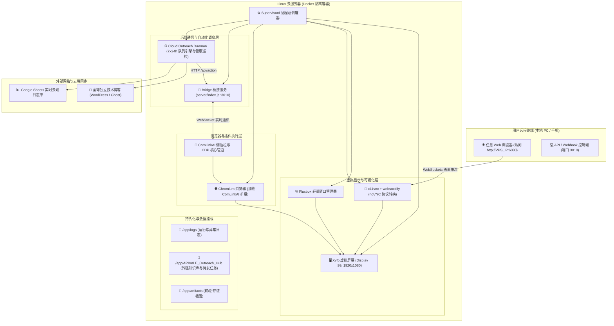

# 🐧 ComLinkAI Linux 云端无头全自动外链引擎部署与运维指南 (7×24h Cloud Headless Daemon)

> 本指南用于指导如何将 ComLinkAI 完整部署在海外 Linux 云服务器（VPS）上，通过 **Docker + Xvfb 虚拟屏幕 + Chromium 插件容器 + noVNC 远程可视化控制台**，打造 24 小时无人值守、高可用、低延迟的自动化博客外链矩阵。

---

## 一、 系统架构设计全景图



---

## 二、 云端部署的五大核心收益

1. **脱离本地物理 PC 束缚**：
   - 本地电脑关机、睡眠或断网均不影响云端引擎持续运行，真正实现 **7×24 小时自动巡航**。
2. **海外网络直连加速，消除超时阻断**：
   - 部署在海外 VPS（美西、欧洲或新加坡），直连 WordPress 博客延时仅 **10~30ms**（国内直连经常面临 2000ms+ 或 `socket hang up`），彻底杜绝由于网络波动导致的发帖超时与掉线。
3. **极高防御穿透与低风控风险**：
   - 欧美数据中心 IP 或原生住宅 IP 访问海外博文，触发 Cloudflare / Turnstile 验证码概率下降 **80% 以上**。
4. **随时随地通过 Web 浏览器巡检 (noVNC)**：
   - 在任何设备（手机、平板、甚至微信内置浏览器）输入 `http://<VPS_IP>:6080/vnc.html`，无需安装任何客户端，即可直接看到云端虚拟屏幕上的 Chromium 界面与侧边栏实时操作过程，支持必要时直接在浏览器上手动拖拽滑块或输入验证码！
5. **容器化一键交付，环境零污染**：
   - 全套环境打包为 Docker 镜像，无论是迁移服务器还是横向扩容多台 VPS，仅需一条命令即可秒级复现。

---

## 三、 VPS 服务器选型与配置建议

| 推荐规格 | 推荐理由 / 支撑场景 | 推荐服务商参考 | 预估成本 |
| :--- | :--- | :--- | :--- |
| **基础型 (1 vCPU, 2GB RAM)** | 满足单实例 7×24h 自动化发帖、定时巡检、日常轻量运行 | **Hetzner** (德国/芬兰 VPS)<br>**DigitalOcean** (美西)<br>**RackNerd / 搬瓦工** | 约 \$4 ~ \$10 / 月 |
| **黄金推荐 (2 vCPU, 4GB RAM)** | Chromium 多标签并发、快速截图、DOM 复杂运算流畅不卡顿 | **Hetzner Cloud** (CPX21)<br>**Vultr** / **AWS Lightsail** | 约 \$10 ~ \$15 / 月 |

> [!TIP]
> **推荐操作系统**：优先选择 **Ubuntu 22.04 LTS** 或 **Debian 12**（官方 Docker 支持最好、内核稳定）。

---

## 四、 一键快速部署实操步骤

### 步骤 1：连接您的 Linux VPS
在本地终端或 Windows PowerShell 中通过 SSH 连接到远程服务器：
```bash
ssh root@<你的VPS公网IP>
```

### 步骤 2：拉取代码仓库
```bash
git clone https://github.com/bshx2024/codexlink.git /opt/comlinkai
cd /opt/comlinkai
```

### 步骤 3：赋予脚本权限并一键安装运行
运行项目自带的自动化部署向导：
```bash
chmod +x deploy_vps.sh start_service.sh
sudo bash deploy_vps.sh
```

**脚本将自动完成以下所有工序**：
- [x] 检测并自动安装最新版 Docker 引擎与 `docker compose` 插件；
- [x] 初始化本地持久化目录（`logs/`, `artifacts/`, `APIVALE_Outreach_Hub/`）；
- [x] 自动配置并放行 Ubuntu 防火墙 UFW 端口（3010 与 6080）；
- [x] 编译构建包含 Xvfb + Chromium + noVNC 的 Docker 镜像并后台驻留；
- [x] 打印出您的专属远程可视化控制台链接。

---

## 五、 控制台与可视化访问

部署完成后，您可通过浏览器直接访问以下两个入口：

### 1. noVNC 远程可视化桌面 (Web GUI)
- **访问地址**：`http://<你的VPS公网IP>:6080/vnc.html`
- **体验**：直接在网页内查看 1080P 高清 Linux 桌面，可观察 Chromium 正在打开的博文、输入框动态、侧边栏打字过程。若遇到极个别需要人工点击验证码的站点，可在网页上直接用鼠标操控点击。

### 2. Bridge 状态检测接口
- **访问地址**：`http://<你的VPS公网IP>:3010/health`
- **预期响应**：`{"status":"ok","port":3010}`

---

## 六、 常用运维指令与管理速查

| 操作需求 | 执行命令 (在 `/opt/comlinkai` 目录下) |
| :--- | :--- |
| **实时查看云端引擎运行日志** | `docker compose logs -f` |
| **查看特定组件日志 (如守护进程)** | `docker compose logs -f comlinkai | grep -E "HealthAudit|任务"` |
| **重启云端自动化服务** | `docker compose restart` |
| **停止云端服务** | `docker compose down` |
| **拉取最新代码并平滑重新编译** | `git pull && docker compose up -d --build` |
| **查看容器内截图存证** | `ls -lh artifacts/` |

---

## 七、 安全防护建议 (生产环境强化)

1. **为 noVNC 可视化界面配置密码**：
   - 默认配置为内网免密；若长期公开暴露在公网，可在 `docker/supervisord.conf` 的 `x11vnc` 启动项后增加 `-passwd your_secure_password` 保护远程画面。
2. **配合 Nginx 反向代理与 HTTPS**：
   - 建议在 VPS 宿主机使用 Nginx 或 Caddy 为 `6080` 端口挂载域名与免费 SSL 证书（如 `https://outreach.yourdomain.com`），实现全链路加密传输。
